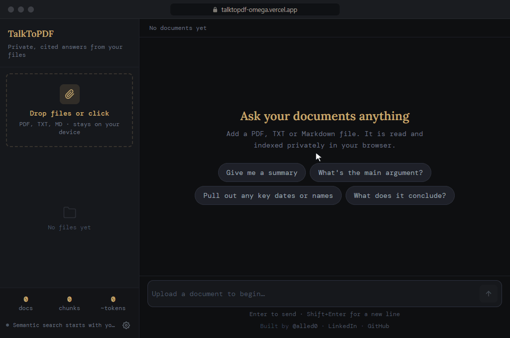
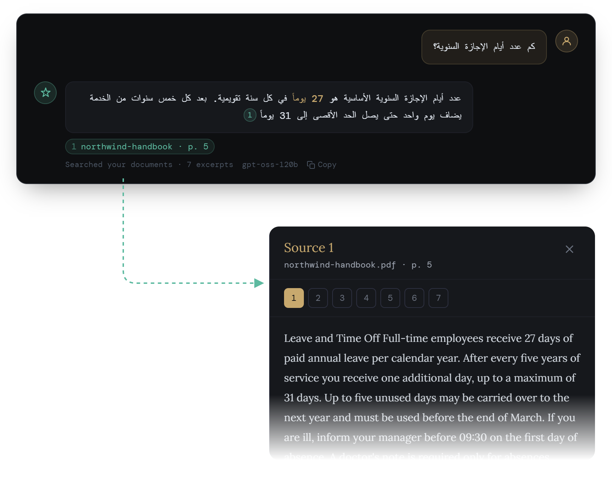
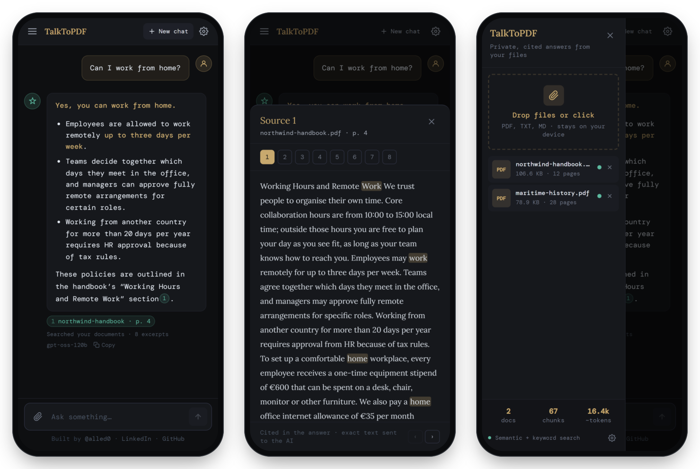
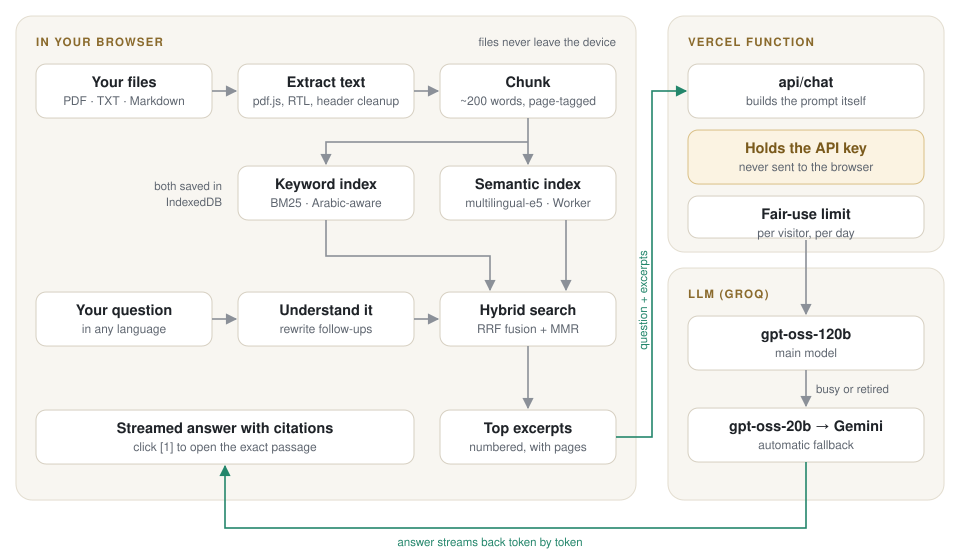

<div align="center">


# TalkToPDF

**Chat with your PDFs and get answers that cite the exact page they came from.**<br>
Search runs privately in your browser. Ask in English, Arabic or 100+ other languages.

[**Try the live demo →**](https://talktopdf-omega.vercel.app)

[](https://github.com/alled0/talktopdf/actions/workflows/ci.yml)
[](https://talktopdf-omega.vercel.app)
[](LICENSE)



</div>

## What it does

Drop in a PDF, ask a question in plain language, and get an answer with numbered citations. Click a
citation to read the exact passage the answer came from, with your search terms highlighted.

Your documents are read, indexed and searched on your own device. Only your question and the few
passages needed to answer it are sent to the AI. It's free to use and needs no account.

## Highlights

- **Answers you can check.** Every `[n]` opens the exact passage and page the model was given.
- **Finds meaning, not just words.** Hybrid search combines BM25 keyword search with multilingual
  embeddings (Reciprocal Rank Fusion), so "how many days off do I get?" finds a passage that only
  says "27 days of paid annual leave".
- **Multilingual, including Arabic.** Right-to-left PDF text is reconstructed correctly, and you can
  ask in Arabic about an English document, or the other way round.
- **Private by design.** Parsing, indexing and search run in the browser, and the library is kept in
  IndexedDB on your device. The site's API key lives only on the server.
- **Handles real documents.** Removes running headers, footers and page numbers, repairs hyphenation,
  splits text into sentence-aligned chunks that know their pages, and warns about scanned pages.
- **Smart context.** Short files are sent whole. Summary questions get passages sampled across the
  document (k-means over embeddings). Follow-up questions are rewritten into standalone searches.
- **Feels like a product.** Streaming answers with stop and retry, starter questions generated from
  your files, drag and drop anywhere, a library and chat that survive a reload, and a mobile layout.
- **Keeps working when a model doesn't.** Answers come from Groq's `gpt-oss-120b` and fall back to
  `gpt-oss-20b` (and optionally Gemini) when a model is busy, out of quota or retired.

## A closer look

**Ask in Arabic about an English document.** The answer comes back in Arabic, and its citation opens
the English passage it was based on.

<p align="center">
  
</p>

**On your phone:** a cited answer, the passage behind it, and your document library.

<p align="center">
  
</p>

## How it works

When you add a PDF, pdf.js extracts its text in the browser. The text is cleaned up and split into
overlapping chunks that remember their pages, then indexed two ways: BM25 for keywords and a
multilingual embedding model for meaning. For each question, the best chunks from both indexes are
merged and sent to `api/chat`, a Vercel function that holds the Groq key, builds the prompt and
streams back an answer with page citations.

<picture>
  <source media="(prefers-color-scheme: dark)" srcset="docs/images/architecture-dark.svg">
  
</picture>

| Step | What happens | Code |
|---|---|---|
| Extract | pdf.js glyphs are rebuilt into lines (right to left where needed). Headers, footers and page numbers are removed. | [`pdfText.js`](src/lib/pdfText.js) |
| Chunk | About 200-word chunks on sentence boundaries, overlapping by about 35 words, each with a page range | [`chunker.js`](src/lib/chunker.js) |
| Keyword index | Incremental Okapi BM25. The tokenizer handles Arabic normalization, light stemming, stopwords and CJK bigrams. | [`bm25.js`](src/lib/bm25.js), [`text.js`](src/lib/text.js) |
| Semantic index | `Xenova/multilingual-e5-small` (q8, about 135 MB, downloaded once) in a Web Worker | [`embed.worker.js`](src/workers/embed.worker.js) |
| Retrieve | RRF fusion, then a relevance cutoff, then MMR diversity, then neighbor expansion. Whole-document mode for short files. Coverage sampling for broad questions. | [`retrieval.js`](src/lib/retrieval.js) |
| Answer | The same prompt builder serves the proxy and the own-key path. Requests fall back across models and providers on rate limits, outages or retired models, and answers stream over SSE. | [`prompts.js`](src/lib/prompts.js), [`providers.js`](src/lib/providers.js), [`api/chat.js`](api/chat.js) |

## Retrieval benchmark

`npm run eval` runs the app's real extraction, chunking and retrieval code over a 12-page
handbook plus a 28-page distractor document. It asks 28 questions, most phrased differently from
the source text and three asked in Arabic about the English handbook. A hit means that the passage
containing the answer is among the excerpts sent to the model.

| Method | Recall@1 | Recall@3 | Recall@6 | MRR | English (25) | Arabic → English (3) |
|---|---|---|---|---|---|---|
| Original TF-IDF (before this upgrade) | 68% | 79% | 86% | 0.75 | 24/25 | 0/3 |
| BM25 only | 71% | 86% | 93% | 0.79 | 25/25 | 1/3 |
| Semantic only | 82% | 89% | 89% | 0.85 | 23/25 | 2/3 |
| **Hybrid (shipped)** | 75% | **93%** | **96%** | 0.84 | **25/25** | 2/3 |

The hybrid gives the best recall, which matters most because the model reads all the excerpts.
Semantic-only search ranks the right passage first more often but misses keyword-heavy questions.
The benchmark is small and synthetic, so treat it as a regression check, not a leaderboard.

## Run it locally

```bash
npm install
cp .env.example .env      # add GROQ_API_KEY for the free tier (get one at console.groq.com/keys)
npm run dev               # serves the app and /api/chat locally
```

Without a server key you can still use the app by pasting your own Groq key in **Settings**.

| Script | |
|---|---|
| `npm run dev` | Vite dev server, including the `/api/chat` function |
| `npm test` | 50 unit tests (`node --test`, no extra dependencies) |
| `npm run lint` | ESLint, including the React Hooks rules |
| `npm run eval` | Retrieval benchmark (downloads the embedding model on the first run) |
| `npm run build` | Production build |

GitHub Actions runs lint, the tests and a production build on every push and pull request.

## Deploy your own

1. Import the repository into Vercel. The framework preset is Vite.
2. Set `GROQ_API_KEY` ([free key](https://console.groq.com/keys)).

| Variable | Default | Purpose |
|---|---|---|
| `GROQ_API_KEY` | (required) | Main provider for the free tier |
| `GEMINI_API_KEY` | (unset) | Optional overflow when Groq's free quota runs out. Note that Google may use free-tier prompts to improve its products. |
| `GEMINI_MODEL` | `gemini-3.5-flash-lite` | Gemini model used for overflow |
| `DAILY_QUESTIONS_PER_IP` | `25` | Fair-use guard per visitor per day; `0` turns it off |
| `DAILY_HELPER_CALLS_PER_IP` | `100` | The same for query rewrites and starter questions |
| `UPSTASH_REDIS_REST_URL`, `UPSTASH_REDIS_REST_TOKEN` (or Vercel KV's `KV_REST_API_*`) | (unset) | Keeps the guard's counts in a shared store. Without them, counts live in memory per server instance. |

**About capacity.** No free LLM API is unlimited. Groq's free plan gives each model roughly 200K
tokens a day for your whole account, which is a few dozen answers per model. The per-visitor guard
only stops one person (or bot) from using everyone's share, and visitors only see a counter when
they are nearly out. When the shared capacity is used up, the app offers to add a personal Groq
key, which takes about a minute and gives that visitor their own quota. The proxy decides the
model, builds the prompt itself and caps the payload size, so it can't be used as a general LLM
relay.

## Privacy and security

- Files are read, chunked and embedded locally. They are never uploaded.
- The library (text, search index, embeddings) and the conversation are stored in the browser's
  IndexedDB. **Settings → Privacy** deletes all of it.
- Each question sends the question, recent chat turns and the selected excerpts to Groq, either
  directly with your key or through the proxy (and to Gemini instead, if the site owner enabled
  it as overflow).
- A Groq key you add is stored in `localStorage` in your browser and sent only to Groq.
- The site's own Groq and Gemini keys are server-side environment variables, read only by the
  [`api/chat.js`](api/chat.js) function. They never reach the browser: the client uses no `VITE_`
  variables, and the proxy returns only answers and generic error messages.

## Limitations

- Scanned PDFs have no text layer and are rejected. OCR isn't supported yet.
- The first use of semantic search downloads about 135 MB (cached afterwards). Until then, and on
  data-saver connections, search falls back to keywords.
- Answers can only be as good as the extracted text. Complex tables and multi-column layouts may
  read imperfectly.

## Built with

React 18, Vite, Tailwind CSS, pdf.js, Transformers.js (ONNX Runtime Web), Groq (gpt-oss), and Vercel
Functions.

---

<div align="center">

Built by **Alwaleed Almutairi** · [GitHub](https://github.com/alled0) ·
[LinkedIn](https://www.linkedin.com/in/alwaleed-meshal-almutairi-8a48ab263/)

Released under the [MIT License](LICENSE).

</div>
